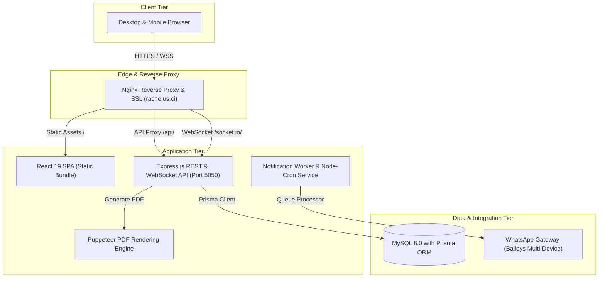

# 🚆 RACHE — Sistem Laporan Operasional Harian Terintegrasi
### PT Kereta Api Indonesia (Persero) Divisi Regional I Sumatera Utara

---

## 📌 Ringkasan Eksekutif

**RACHE** (*Reporting & Automated Coordination Hub Enterprise*) adalah sistem informasi terpadu yang dirancang dan dikembangkan untuk mendigitalisasi serta mengotomatisasi alur pelaporan harian pada **PT Kereta Api Indonesia (Persero) Divisi Regional I Sumatera Utara**. 

Platform ini menyelesaikan kendala fragmentasi data operasional lintas unit, mempercepat rekonsiliasi data angkutan penumpang, barang, sarana/prasarana (KNA), dan keuangan harian, serta menyediakan visibilitas analitik *real-time* kepada jajaran manajemen eksekutif.

---

## 🏛️ Arsitektur Sistem

---

## 🎯 Fitur Utama

### 1. 🏢 Multi-Unit Role-Based Operational Reporting
Sistem memisahkan alur penginputan dan verifikasi secara ketat berdasarkan hierarki wewenang:
- **Unit Kantor Non Angkutan (KNA)**: Pelaporan armada lokomotif, kereta, gerbong, serta kesiapan sarana prasarana.
- **Unit Angkutan Barang**: Pelaporan tonase harian, ritase komoditi (CPO, BBM, Karet, Pasir Kuarsa), dan pencapaian target volume.
- **Unit Angkutan Penumpang**: Pelaporan okupansi kereta api penumpang (KA Putri Deli, Siantar Ekspres, Sribilah), pendapatan tiket, dan ketepatan waktu (*On-Time Performance*).
- **Unit Keuangan**: Rekapitulasi arus kas harian, realisasi pendapatan lintas unit, dan anggaran operasional.
- **Unit Pusat & Admin Global**: Monitoring menyeluruh, persetujuan bertingkat (*Approval / Reject / Revision workflow*), dan verifikasi validitas data.
- **IT Support**: Pemantauan kesehatan server, audit log aktivitas, manajemen kredensial, dan modul *Helpdesk assistance*.

### 2. ⚡ Real-Time Synchronization & Notifikasi
- Didukung oleh **Socket.io** untuk pembaruan status laporan secara instan tanpa perlu me-refresh browser.
- Integrasi **WhatsApp Gateway (Baileys Engine)** untuk pengiriman reminder otomatis batas waktu pengisian laporan harian (*deadline enforcement*) dan alert revisi langsung ke nomor petugas terkait.

### 3. 📄 Automated Document Generation Engine
- **High-Fidelity PDF Export**: Menggunakan Chromium Headless via Puppeteer 24 dengan template HTML/Handlebars berstandar kop surat resmi PT KAI, tabel komparasi dinamis, dan legalisasi digital.
- **Excel Spreadsheet Export**: Menghasilkan file Excel multi-sheet terstruktur dengan formula otomatis menggunakan ExcelJS untuk kebutuhan arsip dan audit korporat.

### 4. 📊 Dashboard Analitik & Business Intelligence
- Visualisasi interaktif menggunakan Recharts menampilkan tren performa harian, persentase ketercapaian target bulanan, dan perbandingan performa antar-stasiun/unit kerja.

---

## 🔐 Keamanan & Standar Kepatuhan Data

- **Autentikasi & Otorisasi**: JSON Web Token (JWT) dengan *stateless expiration* dan enkripsi password menggunakan algoritma `bcryptjs` (12 salt rounds).
- **Audit Logging**: Setiap aksi krusial (pembuatan laporan, perubahan data, revisi, hingga penghapusan) tercatat rapi pada tabel audit trail dengan metadata IP, user agent, dan timestamp ISO.
- **Hardened HTTP Headers**: Perlindungan terhadap XSS, Clickjacking, dan MIME-sniffing menggunakan konfigurasi Helmet dan CORS whitelist ketat.

---

## 👥 Hak Akses & Akun Sistem

| Role | Cakupan Wewenang | Domain Kerja |
| :--- | :--- | :--- |
| **IT Support** | Manajemen sistem, monitoring performa, konfigurasi gateway, unlock akun pengguna | Sistem Global & Server |
| **Admin Global** | Tinjauan laporan seluruh unit, persetujuan (*approval*), analitik eksekutif, rekapitulasi data | Divre I Sumatera Utara |
| **User Unit KNA** | Pelaporan kelaikan armada, inventaris lokomotif dan sarana | Operasional KNA |
| **User Unit Barang** | Pelaporan komoditi barang, tonase harian, dan monitoring mitra kargo | Angkutan Barang |
| **User Unit Penumpang** | Pelaporan volume penumpang, pendapatan tiket harian, okupansi rute | Angkutan Penumpang |
| **User Unit Keuangan** | Pelaporan realisasi penerimaan kas dan rekonsiliasi finansial | Keuangan Divre I |

---

## 🌐 Tautan Produksi

Aplikasi ini dapat diakses secara publik pada infrastruktur cloud:
- **Production URL**: [https://rache.us.ci](https://rache.us.ci)
- **Deployment Platform**: Tencent Cloud Lighthouse (Singapore)
- **Status API Gateway**: Healthy & Monitored
